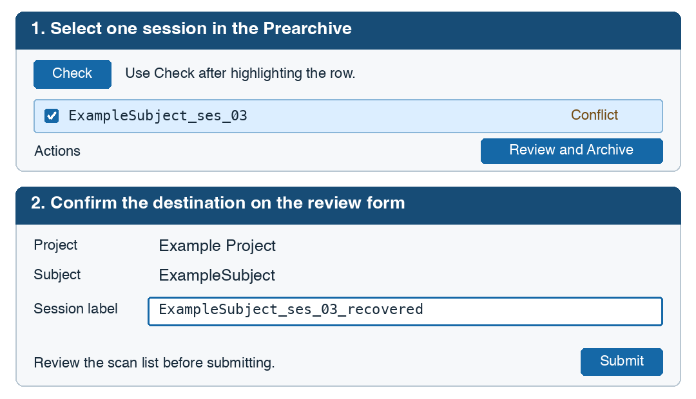

Understanding the Prearchive
============================

The **Prearchive** is XNAT's staging area for uploaded imaging sessions. Use it
to check that an upload contains the expected scans and is assigned to the right
project and subject before saving it to the Archive. Depending on your project
settings, XNAT may archive uploads automatically or leave them for manual review.

Find and review an upload
-------------------------

1. Sign in to XNAT and choose **Upload** > **Go to prearchive**.
2. Find the row for your **Project**, **Subject**, **Session** and **Scan Date**.
   If it is missing, check the filters and use **Refresh**.
3. Click the row to highlight it. Use **Details** to inspect the session and scan
   list. Compare the scans and file counts with what you expected to upload.

* **Ready**: Review the upload and archive it when it is complete.
* **Receiving** or **Building**: Wait for XNAT to finish receiving or preparing
  the session, then refresh the list.
* **Conflict**: Compare the staged upload with the existing archive session.
  If both copies should be kept, use an unused session label when archiving.
* **Error**: Review the error in **Details**. Contact XNAT support if the error
  persists or if you are unsure how to proceed.

.. _review-and-archive-prearchive:

Review and archive a session
----------------------------

Use **Review and Archive** to verify the destination of one staged session.
You need permission to archive data in the destination project.

If the upload is incomplete, belongs to a different subject, or duplicates a
complete archive session, ask the project owner or XNAT support to review it
before archiving.

1. Highlight the intended row, then click **Check** above the table. Confirm
   that only that session is checked. Highlighting a row shows its details.
   Checking it selects it for the archive action.
2. Click **Review and Archive** in the **Actions** panel.
3. On the review form, confirm the **Project** and **Subject** and review the
   scans. Find the editable field containing the current **session label**.
4. Keep the proposed label if it is unused. To archive the upload as a separate
   session, enter a label that is unused in that project. Follow your project's
   naming convention. For example, a fuller export of
   ``ExampleSubject_ses_03`` might be saved as ``ExampleSubject_ses_03_recovered``.
   The recovery label refers to the same visit.
5. Click **Submit**. If XNAT warns that it will merge with or overwrite an
   existing session, cancel and recheck the destination and label.

   Illustration with example labels. Use **Check** to select the row, then edit
   the label on the **Review and Archive** form.

Verify the archived session
---------------------------

1. Wait for archiving to finish. Use **Refresh** if the row still shows
   **Archiving now**.
2. Open the destination project and subject, then locate the session under the
   label you submitted.
3. Confirm the project, subject, scan date, scan list and available file counts
   against the upload you reviewed. If you saved a recovery copy, identify the
   verified session when handing it off for analysis.

For a Study Instance UID mismatch, see :doc:`uid_errors_archiving`.

See Also
--------

- :doc:`uploading` - Upload procedures and methods
- :doc:`uid_errors_archiving` - Resolving UID errors in Prearchive
- :doc:`transferring_data` - Transferring data between projects
- `XNAT Wiki: Using the Prearchive <https://wiki.xnat.org/documentation/using-the-prearchive>`_
