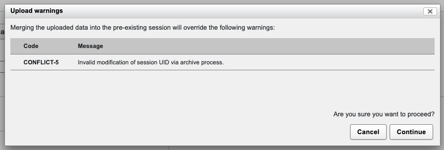

Resolving UID Errors During Archiving
======================================

This guide explains how to identify and resolve UID (Unique Identifier) errors that occur during the archiving process, particularly when attempting to merge data from different sessions with conflicting UIDs into a single XNAT session.

Overview
--------

UID errors during archiving typically occur when:

- **Merging different sessions**: Attempting to combine data from multiple DICOM sessions (each with unique UIDs) into a single XNAT session
- **Transferring data**: Moving data between projects where session labels are manually mapped to match existing sessions
- **Bulk uploads**: Uploading multiple sessions simultaneously where some sessions are incorrectly mapped to the same target session

When XNAT detects that incoming data contains UIDs that conflict with an existing session's UIDs, it prevents the archiving operation to maintain data integrity. These errors are most commonly encountered during the archiving step, after data has been uploaded to the Prearchive.

Understanding DICOM UIDs
--------------------------

DICOM (Digital Imaging and Communications in Medicine) files use a hierarchical system of Unique Identifiers (UIDs) to catalog and organize imaging data. Understanding this system is crucial for understanding why UID conflicts occur.

**How DICOM Databases Catalog Files**

DICOM files are organized using several types of UIDs:

- **Study Instance UID**: Uniquely identifies a study (imaging session) from a scanner
- **Series Instance UID**: Uniquely identifies each scan series within a study
- **SOP Instance UID**: Uniquely identifies individual DICOM files

These UIDs are embedded in every DICOM file's header and serve as the primary mechanism for organizing and tracking imaging data in DICOM-compliant systems.

**Why UIDs Are Critical for Data Integrity**

UIDs ensure that:

- Each imaging study can be uniquely identified across different systems
- Data from different scanners or sessions can be distinguished
- Files can be correctly associated with their parent studies and series
- Data integrity is maintained when files are moved or copied between systems

Identifying the Problem
-----------------------

A **Conflict** can occur when a staged upload targets a session label already
used in the project. In **Details** or the upload error log, look for
``Invalid modification of session UID via archive process``. This means XNAT
rejected an attempt to archive incoming data under an existing session with a
different Study Instance UID.

A session label is the name you see in XNAT. The Study Instance UID is stored
in the DICOM headers. A revised export can contain the same images with
different DICOM identifiers, so matching scan names or images alone do not
establish that a merge is appropriate.

   A UID conflict warning when archiving into an existing session.

Step-by-Step Resolution
-----------------------

1. Open **Upload** > **Go to prearchive** and find the conflicting row.
2. Compare the staged upload and the archived session. Confirm the project,
   subject and scan date, then check the scan list and file counts. If the
   archive already contains everything you need, leave the staged entry for
   review by the project owner.
3. If the staged upload is a separate study or a verified recovery copy that
   should be kept, follow :ref:`review-and-archive-prearchive`. Check one row,
   open **Review and Archive**, and give the staged upload an unused session
   label in the intended project and subject.
4. After archiving, verify that the new label and expected scans and files
   appear in the Archive.

.. caution::

   If the destination needs to be an existing session, ask the project owner
   or XNAT support to review the UID mismatch before continuing. An unused
   session label gives the upload a separate entry in the Archive. The label
   and the DICOM Study Instance UID are separate fields.

See Also
--------

**Related Documentation**

- :doc:`prearchive` - Detailed information about the Prearchive system
- :doc:`uploading` - Detailed upload procedures and methods
- :doc:`transferring_data` - Guide for transferring data between projects
- :doc:`install_desktop_client` - Desktop Client installation guide
- :doc:`access` - Project access and permissions information

**Official XNAT Documentation**

- `XNAT Wiki: Archiving Data search <https://wiki.xnat.org/search.html?l=en&max=10&ol=&q=Archiving+Data&s=documentation&start=0>`_ - Official documentation search results for the archiving process
- `XNAT Wiki: Prearchive search <https://wiki.xnat.org/search.html?l=en&max=10&ol=&q=Prearchive&s=documentation&start=0>`_ - Official documentation search results for the Prearchive system

**Support**

- Contact XNAT administrators at admin.nyuad.xnat@nyu.edu for assistance with persistent UID conflicts or complex scenarios
